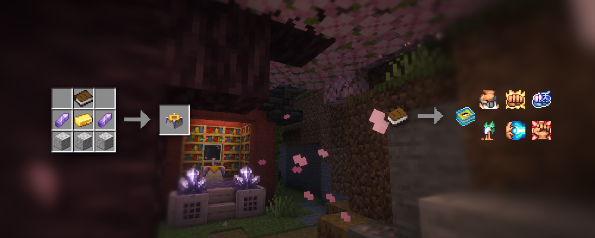

**How do you receive and cast the spells?**
* The spells come from the Force Mastery spell book. It needs to be equipped to cast its spells.
* You need a Knuckle equipped to cast the spells.
* To get the spell book, find or craft a Spell Binding Table.
* You can find a Spell Binding Table in villages with the [Gazebos](https://www.curseforge.com/minecraft/mc-mods/gazebos) mod.
* Make sure to place bookshelves around the Spell Binding Table.
* Spell Scrolls with a single spell can be found as loot. They can be bound to your spell book.

**What does the Forcemaster do?**
* Fights with fast Knuckle attacks that deal physical and magical damage.
* Builds up Arcane Overflow with its spells and uses it to empower its melee hits.
* Strengths: Fast attacks dealing physical and magical damage.
* Weaknesses: Ranged enemies.
* Equipment: Light Armor

##  Force Mastery (Spell Book)

<!-- SPELLS:force_mastery -->
| Icon | Skill | ID | Description |
|---|---|---|---|
|  | Stonehand | `forcemaster_rpg:stonehand` | Increases attack damage, and fist attacks can stun the target. |
|  | Belial Smashing | `forcemaster_rpg:belial_smashing` | Charges toward the target's direction, punching all enemies in your path. |
|  | Asalraalaikum | `forcemaster_rpg:asal` | A devastating charged punch that consumes Arcane Overflow and exhausts the caster. |
|  | Baraqijal Esna | `forcemaster_rpg:baraqijal_esna` | Launches a bolt of Baraqijal's light, stacking the target with Light of Baraqijal, lowering its arcane resistance and damaging it over time. |
|  | Sonic Hand | `forcemaster_rpg:sonic_hand` | Unleashes a rapid series of blindingly fast fist strikes. Consumes Arcane Overflow. |
|  | Nen Sphere | `forcemaster_rpg:nen_sphere` | Charge a magic sphere and release it as a piercing beam. The longer you charge, the harder it strikes, but you get overloaded with Arcane Overflow. |
<!-- /SPELLS:force_mastery -->

## Effects

| Effect | Description |
|---|---|
| Arcane Overflow | Increases Arcane Spell Power and Arcane Fuse, enhancing melee hits with Arcane Magic. |
| Nen Focus | You can stack Arcane Overflow with melee attacks. |
| Stonehand | Increases attack damage, and fist attacks have a chance to stun the target. |
| Light of Baraqijal | Reduces offensive attributes. |
