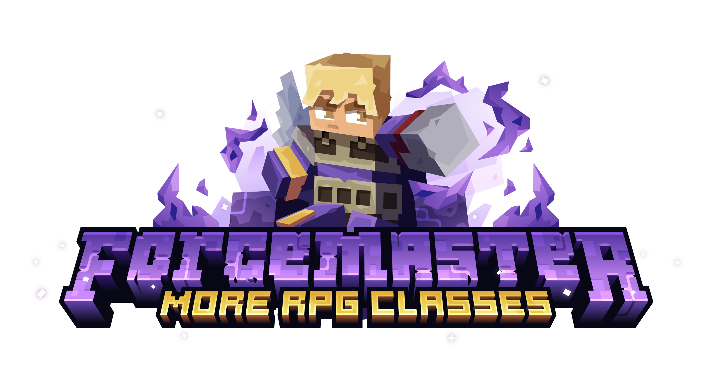
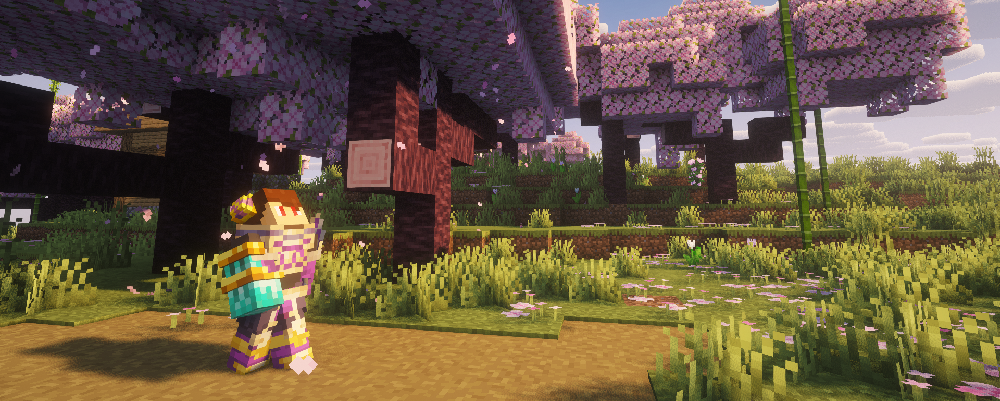
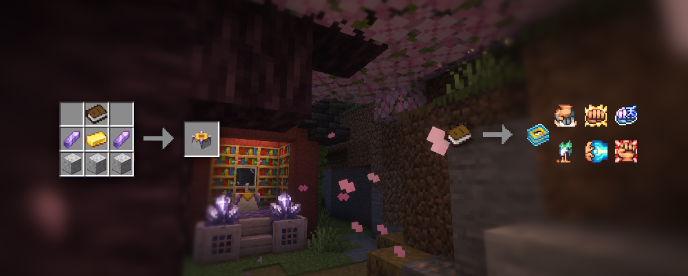
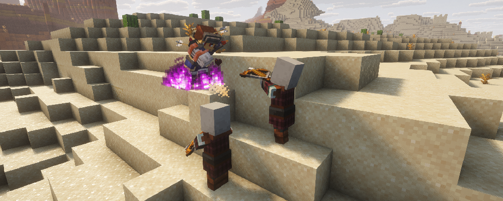
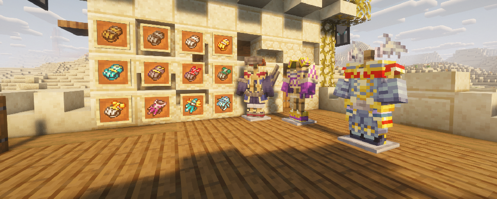

<h1>Grab a Knuckle, master the force and martial art!</h1>
    

---

## 📂 Installation

### Required Mods

<table>
<thead><tr><th>Mod</th><th>Download</th></tr></thead>
<tbody>
<tr><td><b>Spell Engine</b></td><td> </td></tr>
<tr><td><b>More RPG Library</b></td><td> </td></tr>
<tr><td><b>Armor Model API</b></td><td> </td></tr>
</tbody></table>

Fabric needs Fabric API as well. On NeoForge, the mod runs with NeoForge 21.1 or newer.

### Highly Recommended / Compatibility Mods

<b>Show recommended &amp; compatible mods</b>

<table>
<thead><tr><th>Mod</th><th>Compatibility Info</th><th>Download</th></tr></thead>
<tbody>
<tr><td><b>Better Combat</b></td><td>Suggested dependency only, Forcemaster has no extra content for it</td><td> </td></tr>
<tr><td><b>BetterNether</b></td><td>Ruby Knuckle, repaired with Nether Ruby</td><td> </td></tr>
<tr><td><b>BetterEnd</b></td><td>Aeternium Knuckle, repaired with Aeternium Ingot</td><td> </td></tr>
<tr><td><b>The Aether</b></td><td>Holy Knuckle, repaired with Ambrosium Shard</td><td> </td></tr>
<tr><td><b>Armory (RPG Series)</b></td><td>Billporon armor set (Billporon's Focus)</td><td> </td></tr>
<tr><td><b>Arsenal (RPG Series)</b></td><td>Federhorn Knuckle (Nen Focus) and Knuckle of Madness (Carve melee)</td><td> </td></tr>
<tr><td><b>Loot &amp; Explore</b></td><td>Wyrm's Claw, Fist of Tides, Wither's Bash and Glacial Fist, which also count for Loot &amp; Explore's smithing advancements</td><td> </td></tr>
</tbody></table>

---

## 🕹️ Features

The Forcemaster is a melee class that fights with fist weapons called Knuckles. Fast attacks deal physical and magical damage, and the Force Mastery spell book adds spells on top of your punches.

### Spells

Equip a Force Mastery spell book and hold a Knuckle to use its spells. The spell book comes from a Spell Binding Table, so build one with bookshelves around it. Spell Scrolls with a single skill can also drop as loot.

Spell Binding Tables can also be found in villages with the [Gazebos](https://www.curseforge.com/minecraft/mc-mods/gazebos) mod.

**Force Mastery**

The spell book of the Forcemaster: martial art with the knuckle, dealing melee and arcane damage. Stonehand, Belial Smashing, Asalraalaikum, Baraqijal Esna, Sonic Hand and Nen Sphere are all part of it. The full list is in the wiki.

### Combat & Equipment

- Craft and find Knuckles, from wooden up to netherite, plus unique Knuckles from other mods
- Wear the Oriene, Phasleb and Aken armor sets, light armor for fast fighters
- Equipment drops more often for players who carry the matching spell book

---

## ⚙️ Configuration

<b>Show config files</b>

<table>
<thead><tr><th>Setting</th><th>File</th></tr></thead>
<tbody>
<tr><td>Weapon &amp; armor stats</td><td><code>config/forcemaster_rpg/equipment_v3.json</code></td></tr>
<tr><td>Tweaks (e.g. ignore required mods for items, Stonehand stun duration, Light of Baraqijal)</td><td><code>config/forcemaster_rpg/tweaks_v1.json</code></td></tr>
<tr><td>Status effects</td><td><code>config/forcemaster_rpg/effects_v7.json</code></td></tr>
</tbody></table>

---

## 🎥 Showcases

<b>Show video</b>

<!-- SHOWCASE: YouTube-Video hier einfügen (Format wie bei Bard) -->

Thanks to all content creators for showcasing my mod

---

## 🙌 Credits

<b>Show credits</b>

<table>
<thead><tr><th>Who</th><th>Contribution</th></tr></thead>
<tbody>
<tr><td><a href="https://slepykat.carrd.co/">Slepykat</a></td><td>Artist</td></tr>
<tr><td>HaxTheCharizard</td><td>Artist</td></tr>
</tbody></table>

---

<h3>Check out my other RPG-themed mods!</h3>
<!-- BANNERS:own -->
<table>
<tbody>
<tr><td align="center" style="text-align:center"></td><td align="center" style="text-align:center"></td><td align="center" style="text-align:center"></td></tr>
<tr><td align="center" style="text-align:center"></td><td align="center" style="text-align:center"></td><td align="center" style="text-align:center"></td></tr>
<tr><td align="center" style="text-align:center"></td></tr>
</tbody>
</table>
<!-- /BANNERS:own -->

<h3>Discover more of the RPG Series by Daedelus</h3>
<!-- BANNERS:series -->
<table>
<tbody>
<tr><td align="center" style="text-align:center"></td><td align="center" style="text-align:center"></td><td align="center" style="text-align:center"></td></tr>
<tr><td align="center" style="text-align:center"></td><td align="center" style="text-align:center"></td><td align="center" style="text-align:center"></td></tr>
<tr><td align="center" style="text-align:center"></td><td align="center" style="text-align:center"></td><td align="center" style="text-align:center"></td></tr>
</tbody>
</table>
<!-- /BANNERS:series -->

<h3>More RPG content by other Spell Engine devs</h3>
<!-- BANNERS:others -->
<table>
<tbody>
<tr><td align="center" style="text-align:center"></td><td align="center" style="text-align:center"></td><td align="center" style="text-align:center"></td></tr>
</tbody>
</table>
<!-- /BANNERS:others -->

---

Questions, bugs or ideas? Join the <a href="https://discord.com/invite/AShKd5XrTu">Discord</a> or open an issue on <a href="https://github.com/ProfessorFichte/Forcemaster/issues">GitHub</a>.

